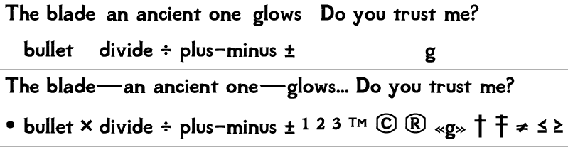

# Sovngarde Font Plus

Adds the usual missing UTF-8 symbols to the **Sovngarde** interface font from
[Sovngarde - Mist's Font Replacer](https://www.nexusmods.com/skyrimspecialedition/mods/386)
(Nexus 386, v8.9) — in the game's Scaleform movies **and** in the Desktop
Edition TrueType faces — **without altering a single existing glyph**.

The stock font covers Latin, Central-European and Cyrillic well, but not day to
day typography: an em dash (`—`) or an ellipsis (`…`) simply does not render.
That is what this fixes.

## What it adds

| use | characters |
| --- | --- |
| dashes and dots | `‐` U+2010 `‑` U+2011 `–` U+2013 `—` U+2014 `…` U+2026 `−` U+2212 |
| symbols | `•` U+2022 `×` U+00D7 `≠` U+2260 `≤` U+2264 `≥` U+2265 `†` U+2020 `‡` U+2021 |
| superscripts | `¹` U+00B9 `²` U+00B2 `³` U+00B3 |
| marks | `™` U+2122 `©` U+00A9 `®` U+00AE |
| quotes | `‹` U+2039 `›` U+203A |

`±` (U+00B1) and `÷` (U+00F7) are already in the font and are left alone; the
Light faces already carry `−` U+2212, so they gain 20 of the 21.



Top: the shipped movie — the dashes, the ellipsis and the second line's symbols
render as nothing. Bottom: this build. (Rendered from the movies themselves with
this repository's rasteriser, `tools/preview.py`.)

## How the new glyphs are drawn

Nothing is invented next to the design: every glyph is derived from the font's
own outlines, so weight, height and placement are the font's.

- **em dash / en dash**: the font's own `-`, stretched horizontally while keeping
  its side bearing (48/1000 em). That gives a 0.904 em bar on a 1 em advance and
  a 0.404 em bar on 0.5 em — the proportions measured on DejaVu Sans
  (0.902 / 1.0 and 0.402 / 0.5), Liberation and FreeSans.
- **ellipsis**: the font's `.` three times at its own advance, so `…` renders
  *exactly* like `...`; the advance is 3 periods.
- **minus `−`**: the `-` stretched to the width of the font's `+`, on the maths
  axis.
- **`×`**: the `+` rotated 45°, same box, same stroke thickness.
- **`≠` `≤` `≥`**: the font's `=` `<` `>`, struck through or underlined.
- **superscripts `¹²³`, `™`, `©`, `®`, `‹›`**: the font's `1 2 3`, `T M`, `C`,
  `R`, `« »` scaled and/or raised to the proportions measured in
  DejaVu/Liberation/FreeSans (a superscript 0.42 em tall whose top sits at the
  cap height; a 0.70 em ring for `© ®`).
- **`†` `‡`**: drawn from the font's stroke thickness (0.80 em tall, 0.40 em
  crossbar).

The primitives (`bullet`, `†`, `‡`, the `©`/`®` rings) are built from the
font's own thickness, x-height, cap height and maths axis rather than copied
from another face.

## Still missing (ranked by what mod text actually uses)

`docs/coverage.md` is the full report (`tools/coverage.py` regenerates it) and
is measured on the **shipped** files, so its "missing" list is the pre-patch
baseline. What a second batch would want, in order:

1. `§ µ ¶ ¨ ¸ ¬ ¼ ½ ¾` — the Latin-1 signs and fractions (present in the book
   font, absent from the interface).
2. `← ↑ → ↓ ⇐ ⇒` and `★ ☆ ♥ ♦ ♣ ✓ ✗ ● ○ ■ □ ⚠` — what mod UIs use for lists,
   progress and warnings.
3. `⁰⁴⁵⁶⁷⁸⁹`, `′ ″`, `‰`, `№`, `₽ ₴`.
4. `≈ ≡ ∞ √ ∑ ∏ ∫` (`≤ ≥ ≠` are done).
5. The rest of the Cyrillic set: the Bold movie has no `Ѓ Љ Њ Ќ Џ ђ ѕ љ њ ћ џ
   Ґ ґ` (the Light face does), and no `₽`.
6. Greek, entirely absent (rare in Skyrim).

## Install

Install [Sovngarde - Mist's Font Replacer](https://www.nexusmods.com/skyrimspecialedition/mods/386)
first, then this archive on top of it (it replaces the two `.swf` files the mod
installs, and deliberately does not ship `fontconfig.txt`, which belongs to the
base mod). The release assets:

- `SovngardeFontPlus-<version>-fomod.zip` — the game font
  (`Interface/fonts_sovngarde.swf`, `Interface/fonts_sovngardeconsole.swf`);
- `SovngardeFontPlus-<version>-desktop.zip` — the four Desktop Edition faces,
  for use outside the game.

With [Amethyst Mod Manager](https://github.com/ChrisDKN/Amethyst-Mod-Manager) the
FOMOD zip installs in one click from the
[modforge page](https://aviallon-mods.github.io/modforge/); any mod manager
handles both archives.

## Build and verify

```sh
nix develop                       # python + fontTools + FontForge + ruff/mypy/pytest
python -m sovngarde.build         # writes dist/ : the 2 movies and the 4 TTFs
python -m pytest tests -q         # 55 tests: codec, geometry, added glyphs, build
ruff check . && ruff format --check . && mypy
python tools/coverage.py          # coverage report (docs/coverage.md)
python tools/preview.py --ttf dist/desktop/Sovngarde/'Sovngarde Bold.ttf' --freetype
```

CI runs exactly those commands and then the shared
[modforge](https://github.com/aviallon-mods/modforge) pipeline, which assembles
and verifies the two zips from `fomod-package.toml` /
`fomod-package-desktop.toml`; a tag `vX.Y.Z` attaches them to the release, and
every green push to `main` refreshes the rolling `ci` prerelease.

## What is verified, and what is not

Verified, by tests rather than by inspection:

- the codec: decoding and re-encoding every glyph of the three shipped movies
  reproduces **1183/1183 glyphs byte for byte**, and a whole `DefineFont3` tag
  byte for byte;
- the geometry: the movies and the desktop face describe the same design
  (bounding boxes and ink agree; the SWF is the TTF at a uniform 20.4824 twips
  per unit for the interface movie, 28.6589 for the console one, with a guard
  that refuses a mismatched pair);
- every glyph of every movie fits the bounds rectangle the file itself stores
  for it (within 1 twip), old and new alike;
- the added glyphs: their geometry, advances, fill convention, side bearings and
  cmap coverage in every subtable, and that the same codepoint is the same shape
  in the movie and in the desktop face;
- the build: existing glyphs stay byte-identical, the movie is untouched outside
  its font tag, rebuilding from the same sources reproduces the same bytes, and
  the packaging specs point at files the build really writes;
- nine deliberate mutations of the writer (double scale, zeroed advance,
  translated dash, wrong fill index, zero side bearing, unsorted code table, a
  compressed `FileLength`, …) are each caught by a test — see
  `research/swf-font-format.md`.

**Not verified: how the game renders it.** The files are built for mod version
8.9 and have not been loaded by Skyrim here; that is the one check left, and it
needs the game. Two claims therefore stay open in theory: whether Scaleform
looks characters up with a binary search (the code table is stored sorted, as
every Flash-authored font does) and whether it validates `FileLength` (which is
written as the uncompressed size, as the shipped movies do).

## Licence

- **Code** (`src/`, `tools/`, `tests/`, CI): MIT, see `LICENSE`.
- **Fonts** (`upstream/`, `dist/`, everything in the release archives): SIL Open
  Font License 1.1, see `LICENSE-OFL.txt`. The original font is Sovngarde,
  copyright © 2016 mjorka (mjorka.net), with no Reserved Font Name; the Scaleform
  conversion is the work of the mod author. This project is a Modified Version of
  those files (glyphs added, nothing removed or altered) and keeps their name and
  licence, as the OFL requires.

The unmodified upstream files the build reads are vendored under `upstream/` so
that a build is reproducible from this repository alone.
